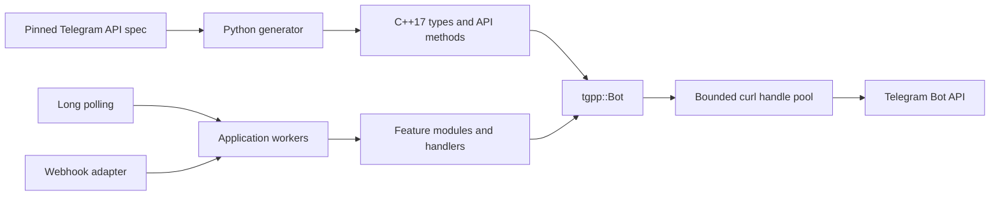
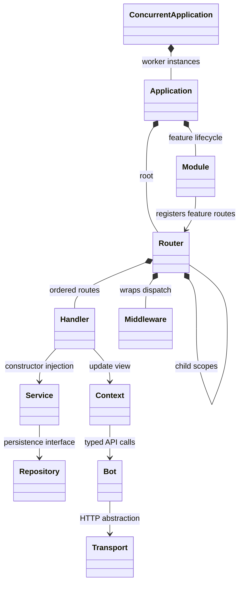
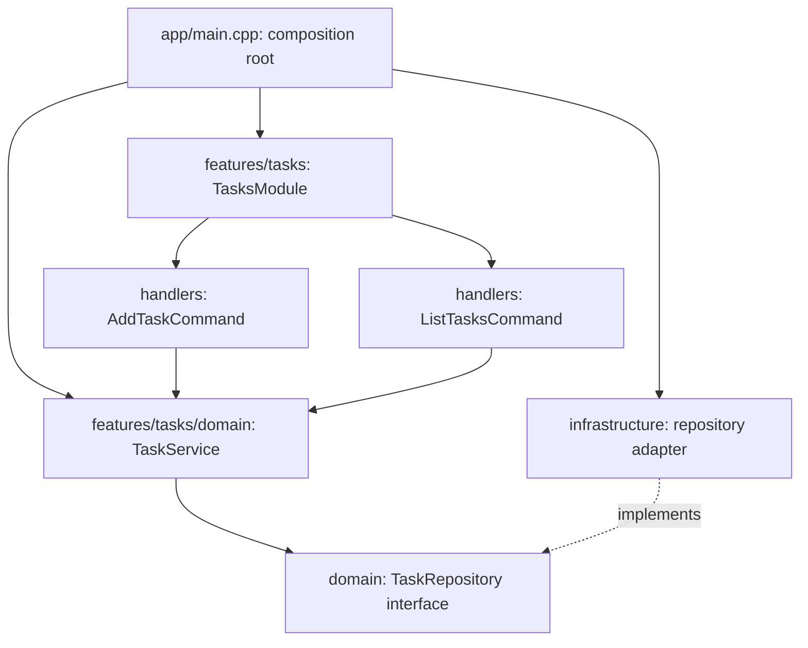
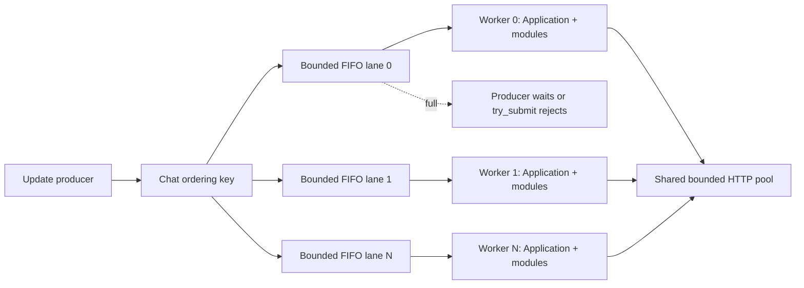
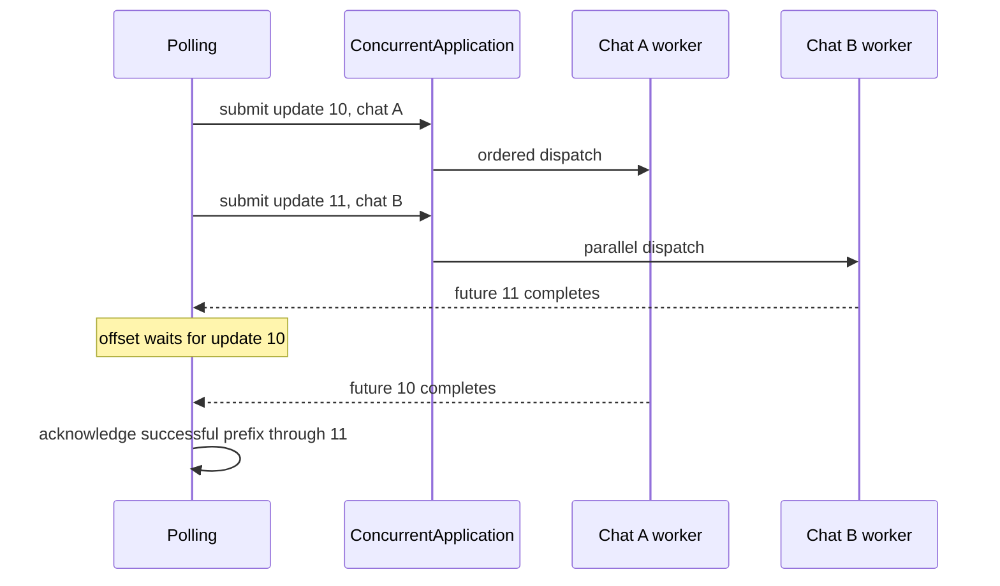

# Building maintainable bots with tgpp

Use `tgpp::Bot` for direct API calls and `tgpp::ext::Application` to organize a
bot into features. The generated client and the handwritten application layer
are separate CMake targets:



```cmake
target_link_libraries(my_bot PRIVATE tgpp::ext)
```

```cpp
#include <tgpp/ext/ext.hpp>
```

## Organize around features

The runnable [modular bot](../examples/modular_bot) follows this structure:

```text
modular_bot/
├── app/
│   ├── config.hpp / config.cpp
│   └── main.cpp                    # Dependency wiring and process startup
├── features/
│   ├── welcome/
│   │   ├── welcome_module.hpp / .cpp
│   │   └── start_command.hpp / .cpp
│   └── tasks/
│       ├── tasks_module.hpp / .cpp  # Feature's registration point
│       ├── handlers/
│       │   ├── add_task_command.hpp / .cpp
│       │   └── list_tasks_command.hpp / .cpp
│       └── domain/
│           ├── task.hpp
│           ├── task_service.hpp / .cpp
│           └── task_repository.hpp # Persistence interface
├── infrastructure/
│   └── memory_task_repository.hpp / .cpp
├── middleware/
│   └── logging_middleware.hpp / .cpp
└── tests/
    └── test_tasks.cpp
```

A new payments or moderation feature gets its own module, handlers, and domain
code. Keep helpers beside the feature that owns them; create a shared component
only when several features need the same behavior. Business rules belong in
services. Parsing Telegram input and sending responses belong in handlers.
Database details belong behind repository interfaces.

## What each class owns

| Class | Responsibility |
| --- | --- |
| `Bot` | Generated Telegram methods and typed requests/results |
| `Application` | Module ownership, lifecycle, dispatch, update error policy |
| `Module` | Register one feature and manage its optional lifecycle work |
| `Router` | Ordered handlers, child routers, filters, scoped middleware |
| `CommandHandler` | Match one command; subclass implements `handle()` |
| `CallbackQueryHandler` | Match a callback-data prefix; subclass handles it |
| `FunctionHandler` | A named predicate and callback for small routes |
| `Middleware` | Wrap a router's dispatch; authenticate, log, or stop it |
| `Context` | Current update, reply helpers, and transient typed metadata |
| `Polling` | Fetch updates and advance the checkpoint after processing |

Favor small classes with injected dependencies. `Application` is not a service
locator, and handlers do not need to inherit from an application-wide bot class.



## A class per command

```cpp
class StartCommand final : public tgpp::ext::CommandHandler {
public:
    StartCommand() : CommandHandler("start") {}
    void handle(tgpp::ext::Context& context) override {
        context.reply("Welcome!");
    }
};

class WelcomeModule final : public tgpp::ext::Module {
public:
    std::string name() const override { return "welcome"; }
    void configure(tgpp::ext::Router& router) override {
        router.add<StartCommand>();
    }
};

tgpp::ext::Application app(transport);
app.install<WelcomeModule>();
tgpp::ext::Polling(app).run();
```

Put declarations in `.hpp` files and implementations in `.cpp` files as a
feature grows. A handler that needs a service receives it in its constructor:

```cpp
auto repository = std::make_shared<MemoryTaskRepository>();
auto service = std::make_shared<TaskService>(repository);
app.install<TasksModule>(service);
```

`TasksModule::configure()` passes that same service into its command classes.
The application owns the module; its feature router owns the handlers. Both
can own shared service references. If passing dependencies by reference, their
owners must outlive the application. Avoid capturing stack references that
expire before polling begins.



## Routing and middleware

Handlers and child routers run in registration order. The first matching
handler processes the update. A child returning `Result::unhandled` allows the
next route to try. Register broad fallback handlers last.

```cpp
auto& private_routes = router.child("private", tgpp::ext::filters::private_chat());
private_routes.add<AddTaskCommand>(service);
private_routes.add<ListTasksCommand>(service);
```

Filters can be combined with `filters::both`, `either`, and `negate`. For update
kinds without a convenience filter, write a predicate against
`context.update()`. The complete generated `Update` is always available.

Middleware wraps the matching process for its router and descendants. A root
middleware runs around every feature; a child middleware runs only when that
child's filter accepts the update. Middleware is outermost in registration
order, so registering A then B produces `A → B → handler → B → A`.

```cpp
class RequireAccount final : public tgpp::ext::Middleware {
public:
    tgpp::ext::Result handle(tgpp::ext::Context& context, tgpp::ext::Next next) override {
        if (!context.user()) return tgpp::ext::Result::stopped;
        return next();
    }
};
router.use<RequireAccount>();
```

Call `next()` synchronously, at most once. A second call or a call retained
until after middleware returns throws. Returning `stopped` prevents later
routes from running. Returning `unhandled` lets an enclosing router try its
next route. Typed `context.set(Actor{...})` / `context.get<Actor>()` metadata
can carry authentication results through one update. For a feature that falls
through, its metadata remains available to later routes on that same update;
use distinct types for feature-specific metadata. Each new update gets a fresh
context. Persistent user sessions belong in an injected store or repository.

## Context and command behavior

`message()` covers direct message, edited message, channel, business, and guest
message updates. A callback's original message is not a direct message update
and does not trigger command handlers. `callback_query()`, `user()`, and `chat()`
provide common views, returning null when the update does not supply one.
Specialized update kinds remain accessible through `update()`.

Commands require a Telegram `bot_command` entity at offset zero. Command tokens
are ASCII; Unicode arguments are retained. `argument_text` preserves the full
trimmed argument string, while `arguments` splits on whitespace without shell
quoting. This follows the entity representation in the
[Telegram Bot API](https://core.telegram.org/bots/api#messageentity).

To match `/start@your_bot`, configure your bot's username before starting:

```cpp
app.set_bot_username(app.bot().get_me().username.value_or(""));
```

Plain `/start` needs no identity request. Addressed commands are ignored when
the identity is unknown or names another bot. Commands from edited messages
are eligible; apply a router filter if a feature should accept only new
`context.update().message` updates.

`reply()` preserves message-thread and business scope, direct-message topics,
and the original message reference. Guest and ephemeral replies require their
explicit generated API methods. `answer_callback()` acknowledges a callback
query. Use `context.bot()` when an operation needs options these helpers do
not expose.

## Lifecycle and errors

Configure all routes and modules before starting. Routing freezes at startup
or the first direct router dispatch; later registration is rejected. A module
starts in installation order and stops in reverse order. Startup failure also
cleans up attempted modules. `Module::stop()` is `noexcept` and must tolerate a
partially completed `start()`. Dependencies used by modules must remain alive
during shutdown.

`process()` starts the application automatically. `stop()` and destruction
clean up once. Stopping during a handler defers cleanup until that handler has
returned. A stopped application is single-use; create a new application to
restart it. Recursive dispatch is rejected by `Application`.

Update exceptions propagate by default. Register `on_error` to log the original
exception, inspect `context.route()` / `handler_name()`, and choose an action:

```cpp
app.on_error([](tgpp::ext::Context& context, std::exception_ptr error) {
    // Send error and route information to your logger.
    return tgpp::ext::ErrorAction::rethrow;
});
```

`ErrorAction::skip` explicitly accepts the failed update and returns
`Result::failed`. Polling then advances past it. Exceptions from the error
handler itself propagate. Parsing malformed JSON happens before a context can
be created, so webhook adapters must handle those errors at their boundary.

Polling advances `offset()` only after a handler succeeds, an update is
unhandled/stopped, or the application explicitly skips a failure. A handler
exception leaves that update unconfirmed. Read `offset()` after `poll_once()`
to persist a checkpoint; pass it through `PollingOptions::request.offset` when
restarting. A crash can replay an update, so payment and job handlers should
use their own idempotency keys. This client makes no automatic retry of handler
side effects or network calls. A service supervisor or adapter can apply a
retry policy appropriate to its storage and operations.

`Polling::run()` stops the application on normal exit or exceptions.
`request_stop()` is safe from another thread, and takes effect after any
in-flight HTTP request. Signal handlers should only update a `sig_atomic_t`
flag and expose it through the optional `run()` predicate, as the example does.

## Concurrent applications

`Application` is the sequential unit of execution. `ConcurrentApplication`
owns a fixed set of independent applications and worker threads, created by
your factory. Incoming updates are moved into bounded FIFO queues, using chat
ID to choose a worker. Messages and callbacks from one chat stay ordered;
different worker lanes execute concurrently. Chats that hash to the same lane
share its queue. Chatless updates use key zero. Supply `ConcurrencyOptions::key`
when ordering must follow a user, business account, or another domain scope.

```cpp
tgpp::ext::ConcurrentApplication app([transport] {
    auto worker = std::make_unique<tgpp::ext::Application>(transport);
    worker->install<WelcomeModule>();
    return worker;
}, {4, 256, {}});

tgpp::Bot bot(transport);
tgpp::ext::Polling(app, bot).run();
```

The factory creates new modules, handlers, and middleware for every worker.
Each application is configured and started before worker execution begins.
Shared repositories and other shared dependencies need their own synchronization
or concurrency-safe clients. Worker-local handler state needs no application-wide
lock. Services that require thread-affine startup should establish those
resources lazily in the worker's handler/service boundary.



`submit(Update)` takes ownership and returns `std::future<Result>`; it waits
when the selected queue is full. `try_submit(Update&)` is nonblocking and moves
the update only when accepted, so a webhook adapter can retain the rejected
payload and apply backpressure. `submit`, `try_submit`, and `request_stop` are
thread-safe; a custom key function must also be thread-safe. Default limits
are four workers and 256 queued updates per worker, plus one active update per
worker. Queue capacity counts updates; size limits on webhook bodies remain
the adapter's responsibility.

`request_stop()` closes acceptance, wakes blocked producers, and drains accepted
work. `shutdown()` joins workers and stops modules in reverse order within
each application. Call it from one external control thread; handlers may call
`request_stop()`. Destroying the dispatcher also drains and joins. Application
and dependency ownership must outlive all accepted work.

Concurrent polling submits the fetched batch and collects futures in update
order. Only a contiguous successful prefix advances the Telegram offset. If
one handler fails, later accepted updates are still drained before the error
returns; their side effects may replay after a restart. Use domain idempotency
keys for writes that must tolerate that replay.



Do not retain `Context`, `Next`, or update views for background jobs; copy needed
values into a job. The [concurrent example](../examples/concurrent.cpp) shows a
complete polling setup. The showcase uses its own per-chat background services
to keep lengthy media tours separate from lightweight update handlers.

## HTTP performance and resource bounds

`CurlTransport` leases exclusive handles from a pool, resets request options
after each call, and retains live connections plus TLS and DNS caches. This
avoids rebuilding the connection on every API call. Handles are never used by
two threads simultaneously, following libcurl's
[threading contract](https://curl.se/libcurl/c/threadsafe.html) and
[reset behavior](https://curl.se/libcurl/c/curl_easy_reset.html).

Configure `CurlOptions::max_connections` (default eight) and
`pool_timeout_seconds` (default 30). An exhausted pool waits with a timeout;
each HTTP call keeps its existing connect and overall timeouts. Reserve capacity
for a long poll as well as handler API calls. TLS verification and redirect
policy are unchanged. Telegram's rate limits still apply.

Build `TGPP_BUILD_BENCHMARKS=ON` and run `tgpp_dispatch_bench` to compare one
and four workers on a fixed simulated I/O workload. Report measurements with
the workload and build configuration; they are not Telegram network throughput.
The HTTP integration test also verifies persistent connection reuse.

## Test at the appropriate boundary

Test domain rules with a fake repository, without Telegram types. Test handlers
and feature registration through `Application::process_json()` with a fake
`Transport`. Test HTTP integration separately. The modular example's test
checks that both task commands share the injected service, isolate users, and
reject group updates before private task handlers run.

## Growing the application

Add callbacks by subclassing `CallbackQueryHandler("tasks:")`; give other
features their own prefixes. Put authorization middleware on the feature router
that needs it. Add a database implementation of `TaskRepository` in
`infrastructure/` when persistence is needed. For multi-step workflows, inject
a session store keyed to the relevant user/chat/business scope, and keep the
transition rules in a domain service. A webhook adapter validates its request
and calls `app.process_json(body)` through the same feature modules; an HTTP
listener is left to your server stack.
